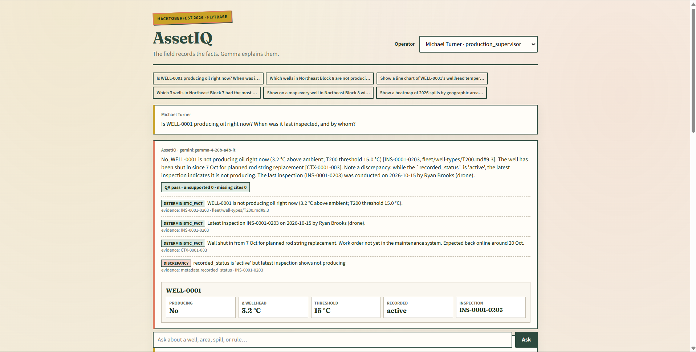
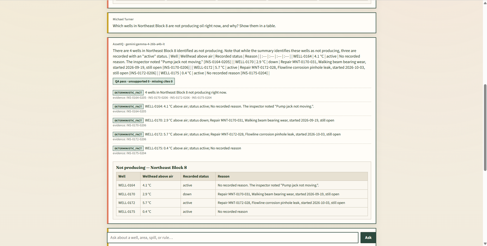
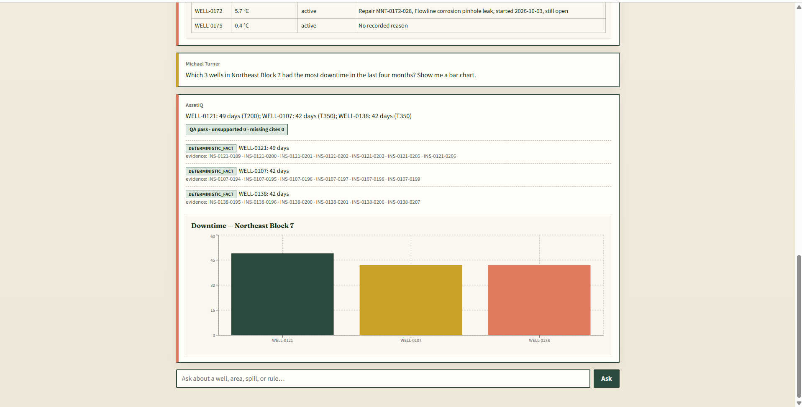

# AssetIQ

**The field records the facts. Gemma explains them.**

An **Asset Intelligence Copilot** — a chat assistant that answers an oil-field operator’s plain-English questions about wells, **correctly**, with **evidence**, over messy multi-source data (inspections, repairs, regulator events, manuals, SOPs, human notes).

We are not training models or analysing images. We engineer the agentic layer in the middle: **store → retrieve → compute → explain → validate**.

[](LICENSE)
[](pyproject.toml)
[](https://hacktoberfest.com/)

---

## What it answers

| Ask… | You get… |
|------|----------|
| Is WELL-0001 producing oil *right now*, and why? | Status card + citations to inspection + well-type manual |
| Which wells in my block are down, and why? | Table — no invented causes when none are recorded |
| Downtime / spill totals / compliance across the field | Bar, map, or heatmap — generated for the question |
| “The three wells we discussed yesterday…” | Private per-user memory (never cross-leaks) |
| “That reading was wrong — remeasure was 41.0 °C” | Formal correction: original kept, applied for everyone at the right scope |
| User claim vs inspection | Conflict surfaced — not silently overwritten |

---

## Architecture

```
  fleet/ + assets/WELL-*/     JSON · JSONL · MD (manuals / SOPs / reports)
              │
              ▼
     Idempotent ingest        dataset_tag = sample | test
     (upsert on natural IDs)
              │
       ┌──────┴──────┐
       ▼             ▼
   MySQL          Hybrid docs
   (numbers)      exact ID · keyword · report_file links
       │             │
       └──────┬──────┘
              ▼
       RuleRegistry           thresholds with source_file#section
              │               (not magic numbers in random functions)
              ▼
       Derived facts          producing · downtime×7 · real spills · breaches
              │               (deterministic — verifiable)
              ▼
       Gemma 4                interpret question · explain evidence · pick visual
              │               (does not invent the numbers)
              ▼
       Answer Envelope        claims + evidence + visual_spec
              │
              ▼
       QA harness             citations resolve · unsupported claims flagged
              │
              ▼
       Generative UI          status card · table · line · bar · map · heatmap
```

Gemma 4 reads the question and explains the evidence. The numbers themselves come from deterministic tools — so the answer stays checkable.

### Turbo Mode

Answers land in three beats so the operator never stares at a blank chat:

1. **Evidence trace** — real steps from the records (inspection IDs, manual sections, corrections)
2. **Facts + visual** — status card / table / chart + QA, usually well under a second
3. **Streaming explanation** — Gemma writes on top of the already-correct answer

Repeat questions hit an answer cache (invalidated when corrections or shared notes change). Before a demo: `python -m assetiq.cli prewarm` keeps the local model warm and primes the cache.

---

## Data / retrieval

| Layer | What it does |
|-------|----------------|
| **MySQL** | Wells, inspections, maintenance, regulatory events, notes — indexed by well / area / type / time. **Numbers are queried, not embedded.** |
| **RuleRegistry** | Business rules as data with provenance. Examples: T200 producing when wellhead − ambient ≥ **15 °C** (`T200.md` §9.3); T350 ≥ **20 °C** (`T350.md` §3); spill reportable ≥ **5 bbl** / written notice **24 h** (SR-01); contain within **4 h** (SR-02); remediation verify **60 d** (SR-03); downtime = **7 days** per not-producing weekly inspection, missed = **0** (Dataset Guide). |
| **Hybrid docs** | Exact ID / section lookup + keyword over manuals, SOPs, free-text reports. Follow `report_file` and `triggered_by_inspection_id` — containment time for SR-02 often lives **only** in the repair report. |
| **Derived facts** | Producing status, downtime days, real spills (corrections applied), compliance breaches — computed in code, then explained. |
| **Memory** | Shared well knowledge (all users) · private per-user conversation · scoped corrections (`valid_from` / `valid_to`). |
| **QA** | Every deterministic claim needs evidence; missing citations get flagged before you trust the answer. |

Add another dataset with `--tag test` without wiping the first (upsert on record IDs).

---

## Why Gemma 4 sits in the middle

Without Gemma you have a query engine. The copilot needs something that can turn a plain-English question into tool calls, then write the answer in operator language without making up IDs or temperatures.

| Role | Model | Cost |
|------|-------|------|
| Reasoning / explanation | Gemma 4 — local `gemma4:e4b` or hosted `gemma-4-26b-a4b-it` | Free / open-weight |
| Optional embeddings path | Ollama `nomic-embed-text` | Free |

---

## Memory (two levels — do not mix them)

| Kind | Scope | Behaviour |
|------|--------|-----------|
| Shared well knowledge | One `asset_id` | Reaches every operator asking about that well |
| Private conversation | One `user_id` | “Wells we discussed yesterday” resolves only for that user |
| Formal correction | Asset or whole well type | Keep original · record who/why · apply at read time for everyone at that scope |
| Unconfirmed claim | Author + well | If it contradicts the inspection, **show both sides** — never auto-overwrite |

---

## Screenshots

### Status card — one well, facts + discrepancy

WELL-0001 is **not** producing (Δ 3.2 °C vs T200 limit 15 °C). Latest inspection, planned shut-in note, and the stale `recorded_status = active` called out as a discrepancy. QA pill: pass.



### Table — area-wide “who’s down and why”

Northeast Block 8: four wells not producing. Open repairs when they exist; inspector notes when they don’t. No invented causes.



### Bar chart — ranked downtime

Northeast Block 7, last four months: WELL-0121 (49 days), then WELL-0138 / WELL-0107 (42 days). Each bar backed by inspection IDs in the claim list.



---

## Quickstart

```powershell
cd C:\Users\DELL\Desktop\Passwords\BUG\assetiq

python -m venv .venv
.\.venv\Scripts\pip install -e .
copy .env.example .env
# fill MYSQL_PASSWORD and GEMINI_API_KEY

.\.venv\Scripts\python -m assetiq.cli gate0
.\.venv\Scripts\python -m assetiq.cli ingest --tag sample
.\.venv\Scripts\python -m assetiq.cli reset-runtime
.\.venv\Scripts\python -m assetiq.cli eval   # golden Phase 1+2 — expect 18/18 on sample
.\.venv\Scripts\python -m assetiq.cli prewarm
.\.venv\Scripts\python -m assetiq.cli ask "Is WELL-0001 producing oil right now?" --user U-201

.\.venv\Scripts\python -m uvicorn assetiq.api.app:app --host 127.0.0.1 --port 8000

# other terminal
cd ui
npm install
npm run dev
```

Load another dataset folder (same layout):

```powershell
.\scripts\ingest_test_dataset.ps1 -Path "C:\path\to\extra-sample-data"
```

---

## What we’ve checked

Smoke runs on the sample dataset (deterministic facts + QA). Not a full scoreboard.

| Question | Result |
|----------|--------|
| WELL-0001 producing now? | No · Δ 3.2 °C · `INS-0001-0203` |
| WELL-0001 spills (4 years) | 6 real spills · 15.1 bbl |
| WELL-0001 downtime 2025 | 21 days |
| Block 8 down / Block 7 downtime / spill map / SR-02 contain | Matched expected IDs and hours in smoke runs |
| Full example suite · heatmap cells | Still running / to be measured |

Thresholds come from the well-type manuals and SOPs via `RuleRegistry`.

---

## Repo layout

```
assetiq/
  src/assetiq/     engine · ingest · rules · derived · agent · memory · qa · api
  ui/              Hacktoberfest-themed generative chat
  assets/          README screenshots
  eval/            smoke eval + offline demo cache
  docs/            good-first issues
  tests/           unit tests (rules / producing math)
  scripts/         gate0 · test-dataset ingest
```

---

## Contribute

- [CONTRIBUTING.md](CONTRIBUTING.md)
- [Good first issues](docs/GOOD_FIRST_ISSUES.md)
- License: [MIT](LICENSE)

---
